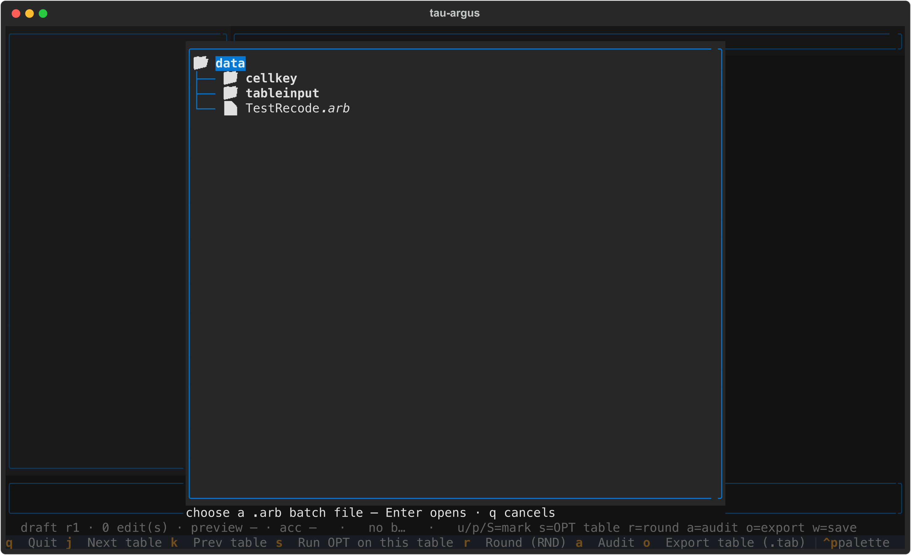
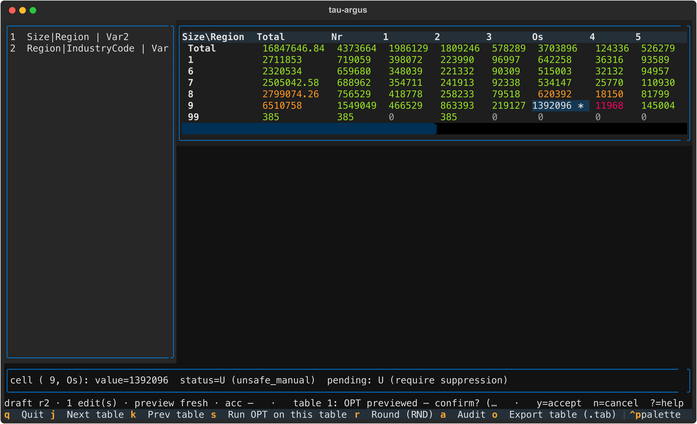

# Tau-Argus TUI User Guide

`pytauargus-tui` is an interactive terminal UI for Tau-Argus. It is a thin,
live view over the `pytauargus` engine. Statistical operations use the same engine
as the headless CLI; the TUI owns draft/history, previews and workspace state.
Widgets do not implement statistical rules or call native bindings directly.

> Architecture and plans: [`docs/ui-design.md`](ui-design.md) (§B.1 to §B.8
> state contracts; §5 Java workflow review and prioritised roadmap). This
> guide describes implemented behaviour; §9 separates future plans.

All screenshots below were captured from the real app running against the
`data/TestRecode.arb` fixture in this repo.

---

## 1. Install & launch

```bash
pip install pytauargus-tui
# or, as an extra of the engine package:
pip install "pytauargus[tui]"
```

`pytauargus-tui` depends on `pytauargus` (the native engine + `tauargus` CLI)
and `textual`, so one install gives you both the headless CLI and the TUI.

Launch:

```bash
tauargus-tui                          # opens a file browser (below)
tauargus-tui path/to/batch.arb        # opens that .arb batch directly
tauargus-tui path/to/batch.workspace.json   # reopens a saved workspace
```

### The file browser (no-argument launch)

With no batch given, a picker opens showing the current directory, filtered
to subdirectories, `.arb` files and saved `.workspace.json` files. `Enter`
opens the chosen file, `q`/`Esc` quits.



---

## 2. Layout


| Region | What it is |
| --- | --- |
| **Navigator** (left) | One row per `specify_table` in the batch: `index  ExpVars \| RespVar`. Switch tables by clicking a row or `j`/`k`. |
| **Grid** (center) | The computed table: row/column labels from the categorical codes, every cell coloured by its status. Move the cursor with the arrow keys. |
| **Detail pane** (bottom, 3 rows) | The cell under the cursor: value, status symbol + full status name, any pending draft mark, and, after an audit, the realised feasibility interval. |
| **Status line** (bottom, 1 row) | The session state and a contextual keymap hint (anatomy in §5). |
| **Footer** (bottom) | The visible key bindings. |

The cursor cell is highlighted; the detail pane and the status-line hint stay
in sync with it.

The current grid supports one or two explanatory dimensions. It has no slice
selector for higher-dimensional tables; use the headless tools for those
tables until full-coordinate views are implemented. Table navigation alone
does not provide coordinated linked-table protection.

---

## 3. Cell status colours

The colour of the number is its status. The symbol in the detail pane is
the status category letter:

| Colour | Symbol | Category | Meaning |
| --- | --- | --- | --- |
| green | `S` | safe | passes all safety rules (or overridden safe, §4) |
| red | `U` | unsafe | a sensitive value that must be protected (hidden or suppressed) |
| cyan | `P` | protect | marked "keep this cell; do not suppress it" |
| yellow | `M` | secondary unsafe | hidden by a suppression so other cells cannot reconstruct a sensitive value |
| dim | `E` | empty | no value (structural or non-structural empty) |
| default | `?` | unknown | status code not recognised |

The full engine status codes (shown by name in the detail pane):

| Code | Name | Category |
| --- | --- | --- |
| 1 | `safe` | S |
| 2 | `safe_manual` | S |
| 3 | `unsafe_rule` | U |
| 4 | `unsafe_peep` | U |
| 5 | `unsafe_freq` | U |
| 6 | `unsafe_zero` | U |
| 7 | `unsafe_singleton` | U |
| 8 | `unsafe_singleton_manual` | U |
| 9 | `unsafe_manual` | U |
| 10 | `protect_manual` | P |
| 11 | `secondary_unsafe` | M |
| 12 | `secondary_unsafe_manual` | M |
| 13 | `empty_nonstructural` | E |
| 14 | `empty` | E |

---

## 4. The workflow: mark, preview, accept

The TUI's core loop is mark cells, preview a method, then accept or cancel. Nothing changes the live table until you accept a preview.

### Step 1: mark cells (draft edits, no solve)

With the cursor on a cell:

| Key | Mark | Effect |
| --- | --- | --- |
| `u` | `U` | *require suppression*, flag this value as unsafe (a sensitive value the standard rules missed) |
| `p` | `P` | *protect*, keep this cell; do not suppress it |
| `S` (shift+s) | `S` | *safe (override)*, mark a false positive as safe |

- A mark is an instant draft edit. No solver runs and the grid does not
  change. The cursor cell gets a bold magenta draft marker
  (`*` = U, `+` = S, `#` = P) and the detail pane shows
  `pending: U (require suppression)` etc.
- Pressing the same mark again removes it; a different mark replaces it.
- `Ctrl+Z` / `Ctrl+Y` undo / redo marks (a new mark clears the redo list).
- Total cells cannot be marked in this iteration (the app logs a message and
  moves on; see *Outstanding*).


Marks tell the solver which values to guard before you run it.

### Step 2: preview a method (throwaway run)

| Key | Method | What it does |
| --- | --- | --- |
| `s` | OPT (cell suppression) | Runs on the whole table, not the cursor cell. The solver chooses the minimum set of cells to hide so that no unsafe (red) cell can be reconstructed from the others. Hidden cells turn yellow. |
| `r` | RND (controlled rounding) | Rounds the table; the rounding base is chosen by the engine. |

The preview runs a full batch on a throwaway copy of your `.arb`
(original spec, then your draft marks, then previously accepted ops, then
the new op).
The live table is untouched. While the preview runs, a spinner shows in the
status line; when it finishes, the preview grid replaces the grid so you
can inspect it, and the status line switches to the pending hint.



### Step 3: decide (`y` accept, `n` cancel)

- **`y` (accept).** The preview becomes the working session. Its results are
  adopted, your pending marks are promoted to confirmed, the undo history
  resets, and the status line records `acc rN` (the accepted revision).
  Accepting also feeds later previews. The next `s`/`r` runs on top of what
  you have accepted so far.
- **`n` (cancel).** The throwaway is discarded; the live table and your
  draft marks are exactly as they were. A failed preview is dropped to the
  log automatically.


Any new mark after an accept makes the last preview outdated (see the status
line below). The preview is never silently stale.

### A large table

`j`/`k` (or clicking the navigator) switch tables. The second table of the
fixture is 18 rows × 707 columns with 1908 unsafe cells:


---

## 5. The status line

The single line above the footer is composed of, left to right:

```text
draft rN · K edit(s) · preview <freshness> · acc rM   ·   <log>   ·   <contextual hint>
```

| Part | Meaning |
| --- | --- |
| `draft rN` | the draft revision, bumped by every mark/undo/redo |
| `K edit(s)` | number of uncommitted (pending) marks |
| `preview —/fresh/outdated` | no preview yet / preview matches the current draft / the draft changed after the preview was run |
| `acc —/rM` | nothing accepted yet / revision M was accepted |
| `<log>` | the engine log stream (truncated in the middle when the terminal is narrow) |
| `<contextual hint>` | the keymap hint for the cell under the cursor |

The hint adapts to the cell kind (legacy §5.6: the apriori letters are
u=unsafe, p=protected, s=safe):

| Cursor on | Hint | Why |
| --- | --- | --- |
| red (U) | `red=sensitive value s=OPT table …` | `s` protects it by hiding the *other* cells that would reconstruct it |
| yellow (M) | `p=keep this cell …` | `p` keeps a hidden cell (do not suppress it) |
| green (S) | `u=flag as unsafe …` | `u` flags a value the standard rules missed |
| otherwise | `u/p/S=mark s=OPT table r=round a=audit o=export w=save ?=help` | the base hint |
| preview pending | `y=accept n=cancel ?=help` | the only time `y`/`n` are live |

The line is always one row. State facts are left-anchored, the hint is
right-anchored, and the transient log sits in the middle (truncated with `…`
when the terminal is narrow).

---

## 6. Audit, export, workspace

| Key | Action |
| --- | --- |
| `a` | **Audit** the current table (legacy `RunAudit`). It computes realised feasibility intervals, and the detail pane shows `interval=[min, max]` for the cell under the cursor. Any subsequent edit invalidates the audit. |
| `o` | **Diagnostic export** of the retained table as a legacy `INTERMEDIATE` `.tab` file to `<arb dir>/out/table_N.tab` (with audit columns when audited). This can contain original sensitive values; it is not a masked publication table. |
| `w` | **Save workspace.** Writes a versioned JSON manifest next to the `.arb` (no solver run; works even before any preview). |
| `R` | **Write replay batch.** Materialises the accepted recipe as a headless-runnable `.arb` (no solver run). |
| `?` / `F1` | **Help overlay** (below). |
| `q` | Quit. |

### Workspace manifests

`w` writes `<batch-stem>.workspace.json` next to the `.arb`, atomically:

| Field | Content |
| --- | --- |
| `version` | manifest schema version (currently `1`) |
| `arb` | path to the input `.arb`, as recorded |
| `input_fingerprint` | sha256 of the `.arb` (input-change detection) |
| `draft_revision` / `accepted_revision` | the revision counters at save time |
| `confirmed_ops` | accepted method runs: `{kind: OPT\|MOD\|RND, tab, rnd_base}` |
| `confirmed_instructions` / `pending_instructions` | cell marks: `{table, dim: [labels], kind: U\|S\|P}` |
| `accepted_summary` | per-table status counts of the accepted outcome |
| `provenance` | `{"pytauargus": <version>}` |
| `tab` | the table in focus at save time |

### Reopening a workspace

The manifest is a replayable recipe, and the TUI can replay it:

```bash
tauargus-tui path/to/batch.workspace.json
```

or pick the `.workspace.json` in the file browser (it is listed next to the
`.arb` files). On reopen the app:

1. **Rebuilds the accepted result through the engine.** The recorded recipe
   (spec + confirmed cell marks + confirmed method ops) is re-run on a fresh
   engine. A replayable recipe does not promise identical optimiser
   tie-breaking; the manifest's `accepted_summary` is reference data, not
   something loaded back in.
2. **Restores the pending draft.** The saved `pending_instructions` come back
   as draft marks, each of them an undoable edit (`ctrl+z` clears one).
3. **Restores the revisions.** The saved `draft_revision` /
   `accepted_revision` and the table in focus, so the status line is
   continuous across the restart.

Explicit reconciliation follows design §B.7. If the `.arb` changed since the
save (fingerprint mismatch) or is missing, the saved outcome is not treated
as current. The current input opens as a fresh session, and the status line
tells you why. An incompatible manifest version is refused with a message
and the file browser opens so you can pick something else.

### Replay batch (`R`)

`R` writes the accepted recipe as a headless-runnable batch next to the
input, `<stem>.replay.arb` (the original batch plus one `<SUPPRESS>` line per
confirmed op and one `<APRIORI>` line per table of confirmed marks, with the
apriori files beside it). `tauargus run <stem>.replay.arb` then reproduces
the recorded operator intent through the headless CLI. No solver run happens
in the TUI when you press `R`. The still-pending draft is not included. The
replay encodes the accepted recipe only. This does not substitute for the
saved workspace, which also carries the draft, the revisions and the
accepted summary.

### Help overlay

`?` (or `F1`) opens the built-in help. The same text is shown in the
screenshot below. Close with `?`/`F1`/`Esc`.


---

## 7. Full key reference

| Key | Action |
| --- | --- |
| `q` | Quit |
| `j` / `k` | Next / previous table |
| arrow keys | Move the cursor within the table |
| `u` | Mark cursor cell U, require suppression (toggle) |
| `p` | Mark cursor cell P, protect (toggle) |
| `S` (shift+s) | Mark cursor cell S, safe override (toggle) |
| `Ctrl+Z` / `Ctrl+Y` | Undo / redo mark |
| `s` | Preview OPT on the whole table |
| `r` | Preview RND on the table |
| `y` / `n` | Accept / cancel the pending preview (only live while pending) |
| `a` | Audit the table (feasibility intervals) |
| `o` | Export the accepted table (`.tab`) |
| `w` | Save the workspace manifest (`.workspace.json`) |
| `R` | Write the replay batch (`<stem>.replay.arb` + apriori files) |
| `?` / `F1` | Help overlay |

---

## 8. What is implemented

- `.arb` batch loading (headless engine run) with the file-browser launch.
- Table navigator for multi-table batches; `j`/`k` + click switching.
- Grid rendering with status colours for all 14 engine status codes.
- Live cell detail (value, status, pending mark, audit interval).
- Draft cell marks `u`/`p`/`S` with toggle/replace semantics, undo/redo.
- Staged preview of OPT and RND on a throwaway session; per-status delta;
  accept (`y`) / cancel (`n`); freshness tracking (fresh/outdated).
- Audit (realised feasibility intervals) with invalidation on mutation.
- Export of the accepted table as a legacy `.tab`.
- Versioned workspace save (atomic, fingerprinted manifest).
- Workspace reopen / restore. Launch on a `.workspace.json` (CLI or file
  browser). The accepted result is rebuilt through the engine, the pending
  draft is restored (undoable), revisions and focus are continuous; stale
  input is reconciled explicitly (fresh session of the current input),
  incompatible versions are refused.
- Replay batch (`R`). The accepted recipe is materialised as a
  headless-runnable `.arb` + apriori files next to the input.
- Status line with state facts + contextual hints, always one row.
- Help overlay; spinner while the engine works.
- 82 automated tests (Textual pilot tests driving the real app, plus model
  and workspace unit tests) live in `bindings/tui/tests/`.

## 9. What is outstanding

The [architecture and Java review](ui-design.md#5-java-workflow-review-and-tui-roadmap-2026-10-12)
owns the full roadmap, source evidence and acceptance gates. These are plans,
not new controls or promised release dates. The table-first layout and
the mark, preview, accept workflow stay central.

1. **Export provenance (§B.7/§B.8).** Export does not yet reuse saved
   accepted export artifacts (the manifest does not reference written `.tab`
   files) or record which revision was written. Reopen recomputes the
   accepted recipe; it does not verify or restore the exact old pattern or
   rounded values. The manifest fingerprints only the `.arb`, not its
   referenced data/metadata/hierarchy/apriori files. Exact accepted artifacts
   and complete dependency identities are part of the output plan.
2. **Marking total cells.** Explicitly deferred. It needs the real total
   code, which the display label does not preserve. The app blocks the mark
   with a log message.
3. **RND base selection.** The rounding base is always the engine's
   `_min_round_base`; the user cannot choose it (the manifest records
   `rnd_base`, so this is ready to grow).
4. **Single session only.** One `.arb` batch at a time; no multi-batch and
   no spec editing from the UI.

### Recommended additions, in order

| Stage | Addition | How it stays simple |
| --- | --- | --- |
| First | Separate imported preparation, protection and output; persist exact accepted artifacts and export revision | Keep preview/accept/export distinct. Current previews replay original batch commands and confirmed ops; they can repeat output writes or return 5008 on repeated OPT |
| First | Complete 3D+ slices, selectable axes and hierarchy levels; real total-code identity | A small View pane; changing the view never changes the protected scope |
| First | Diagnostic versus publication view/output, including rounded values | One output picker, explicit result/revision, verified engine formats; original-value inspection stays clearly labelled |
| Next | Summary, code/label search, next sensitive/audit-failing cell and filters | Contextual commands and dismissible panes rather than permanent toolbars |
| Next | Expanded frequency/cost/protection details and supported audit findings | Keep the short detail pane; expand only when needed and tie evidence to its result |
| Next | MOD selection, custom RND base and supported time limits | One Method pane with validated defaults; settings become undoable recipe changes |
| Next / later | Strict staged apriori import, then costs/levels and bulk edits | Show matched/rejected targets before applying; use the existing draft/history model |
| Later | Read-only recipe/rules, optional recoding and guided recipe creation | Ready `.arb` batches remain the fast path; authoring is optional |
| Engine prerequisite | Linked-table protection and specialist methods | Expose only verified scopes/methods; multi-table navigation is not a joint solve |

The Java review favours its inspection and operator controls over its modal
screen structure. CKM needs a separate capability review despite a Python
dispatch path; unsupported legacy methods and commercial solver settings do
not gain TUI controls merely because Swing had them. Planned interactions have
no assigned shortcuts yet; §7 remains the shipped key reference.

## 10. Screenshot index

| File | State |
| --- | --- |
| `tui-images/01-file-browser.png` | No-arg launch: the `.arb` file browser |
| `tui-images/02-table0-unsafe.png` | Table 0 loaded, cursor on the unsafe (red) cell |
| `tui-images/03-marked.png` | Draft mark `u` on a safe cell (magenta `*`) |
| `tui-images/04-preview.png` | OPT preview pending (`y`/`n` on the status line) |
| `tui-images/05-accepted.png` | Preview accepted (`acc r2`) |
| `tui-images/06-table1.png` | Table 1: 18 × 707 with many unsafe cells |
| `tui-images/07-help.png` | The help overlay (`?`/`F1`) |
