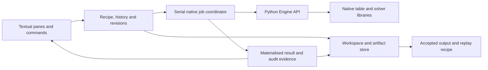

# UI Design: replacing the Java/Swing frontend

Status (2026-10-12): The headless CLI and TUI are shipped on `master` in
release 0.4.0. The TUI has draft marks/history, scratch previews,
accept/discard, audit, workspace save/reopen and replay batches. Reopen
recomputes the recipe; exact accepted artifacts and export provenance remain
unfinished. The [user guide](tui.md) records shipped behaviour; this document
owns architecture, state contracts and the prioritised roadmap (§5).

Sections B.4 to B.8 define the target contract, not a claim of complete parity.
The implementation gaps are explicit in §5.2. Changes use feature branches
and PRs; the historical `tui` branch is a Java porting reference.

State decision (2026-10-11): the workflow is immediate draft edits, then an
explicit solver preview, then accept result, then export. Saving a workspace
is a separate action.

## 1. Background

- The legacy product is a Java/Swing desktop app (`src/tauargus/gui/*`,
  `nbproject/`, SWIG bindings). It has been removed from `master`; the `tui`
  branch retains it as a read-only reference for porting behaviour.
- Task 8 was blocked on the assumption that an interactive frontend must
  replace Swing first. That assumption is dropped. Deleting Swing does not
  require a 1:1 replacement to exist yet.
- The rewrite's product is a headless `.arb` batch CLI
  (`bindings/python/`, entry point `tauargus`). The `Engine`
  (`pytauargus.engine.Engine`) is a clean, importable Python library over the
  pybind11 native core, and `pytauargus.cli` already exposes the full verb
  surface. The TUI is a thin presentation layer over that same library. It
  does not reimplement any engine behavior.

## 2. Decision

The headless CLI remains usable independently (Option A).
Option B is the chosen interactive companion: a separate package released
in lockstep with the engine.

### Option A: headless CLI (the shipped product)

The product is the headless CLI + batch runner. Interactive needs (spec
authoring, table inspection, suppression tuning) are served by:

- the CLI verbs: `run`, `explore`, `specify`, `compute`, `suppress`, `round`,
  `apriori`, `audit`, `save`, `tables`, `version`;
- machine-readable outputs (CSV, INTERMEDIATE `.tab`, audit rows) that feed
  the example notebooks, spreadsheets, or dashboards;
- structured `logger` output for batch observability.

**Pros:** smallest surface, fastest to a releasable product, no new platform
risk, nothing to keep in sync with the engine.
**Cons:** interactive table inspection and suppression tuning require CLI
round-trips or another presentation layer.

### Option B: lightweight ANSI terminal UI

A TUI in the OpenCode terminal aesthetic: monospace, minimal chrome,
keyboard-driven, panes not modal dialogs. A thin interactive layer over the
`Engine`, not a rewrite.

**Library: `textual`** (decided). It is a pure-Python TUI framework with
widgets, panes, key handling, and live updates, the closest fit to the
OpenCode feel, and it ships a virtualized `DataTable` (so wide tables do not
break the terminal, the main risk with a home-rolled `rich` grid).
`rich` + `prompt_toolkit` is the fallback if we want fewer moving parts, but
it forces us to hand-wire pane layout and focus; `textual` gives that for free.

**Distribution: its own PyPI package, `pytauargus-tui`** (decided). It is a
separate project with its own `pyproject.toml` and wheel, but it lives in
this monorepo (`bindings/tui/`, sibling to `bindings/python/`). Related work uses
short-lived feature branches; both packages ship from the same `py-v*` tag:

- the core `pytauargus` wheel stays minimal; `textual` is never a dependency
  of its base installation; `pytauargus[tui]` is an optional convenience extra,
  and `tauargus-tui` is a separate command;
- the release workflow checks matching engine, TUI and tag versions and
  smoke-tests the TUI against the engine wheel built in that run;
- `pip install pytauargus-tui` pulls `pytauargus>=<min>` (the native engine +
  CLI) as its only engine dependency.

- Console script: `tauargus-tui` (distinct from the core `tauargus` CLI).
- Dependency floors live in `bindings/tui/pyproject.toml`; they express
  compatibility, rather than the current coordinated release number.
- Release: `.github/workflows/wheels.yml`, shared `py-v*` tags, separate PyPI
  wheels; the container includes both CLIs.

### B.1 Layout

```text
┌ tables & vars ┬──────────────────────── grid ────────────────────────┐
│ 1 REGION|CA ▸ │ REGION\CA  R1    R2    R3    TOTAL                   │
│ 2 SEXE  |CA   │  R1        S     U     S     S                       │
│ 3 AGE   |CA   │  R2        U     S     U     U                       │
│             │  R3        S     S     S     S                         │
│ [vars]      │  TOTAL     S     U     S     S                         │
├──────────────┴───────────────────────────────────────────────────────┤
│ cell (R2, R3): value=12  status=U (unsafe_rule)  interval=[4, 30]    │
├──────────────────────────────────────────────────────────────────────┤
│ draft r12 · 3 edits · preview outdated · accepted r9 · s=preview OPT │
└──────────────────────────────────────────────────────────────────────┘
```

- **Left pane.** Table navigator (one row per `specify_table`) + the
  explanatory/response vars and active safety rules for the selected table.
- **Center pane.** The computed table as a `DataTable`: rows = one
  explanatory var's codes, columns = another's. Remaining dimensions select
  a slice. Each cell shows the value and is colored by status category;
  pending edits have a separate marker rather than a solver-result colour.
- **Detail pane** (bottom). The selected cell's value, full status name, and,
  when the table has been audited, its realized feasibility interval.
- **Log/status line** (bottom). The engine's `logger` stream + a one-line
  keymap hint, draft revision, pending edit count, preview freshness and
  accepted revision. Busy state remains visible during engine work.

Status color = the `_status_symbol` category from `pytauargus.engine`
(`S` safe=green, `U` unsafe=red, `P` protect_manual=cyan, `M`
secondary_unsafe=yellow, `E` empty=dim). Full status names come from
`pytauargus.cli._STATUS_NAMES` (1-14).

### B.2 Feature to API map

Native operations use the existing Python engine and batch semantics. Draft
editing, history, revisions and workspace persistence belong to the TUI;
they do not require a solver or batch-parser implementation in the widgets.

| Pane / action | Real `pytauargus` surface |
| --------------- | --------------------------- |
| Open data | `open_microdata(data_file, Metadata)` (or `run_batch(arb)` for a ready batch) |
| Table navigator | `eng._n_tables`, `eng._tables[i]` (`spec.exp_vars`, `spec.resp_var`, safety rules) |
| Grid cell value + status | `eng._tau.get_table_cell(tab, dim, 0)`, returns `res[1]`=value, `res[10]`=status; size via `get_total_table_size`, bounds via `get_minimum_cell_value` |
| Detail: feasibility interval | `eng.audit(tab)`, returns rows `{cell,min,max,value,status,unsafe}` |
| Preview suppress / round | On the scratch run: `eng.suppress(Suppress(kind="OPT"/"MOD"/"RND", tab_no=…, rnd_base=…))` |
| Apply draft cell instructions | On the scratch run: `eng.apply_apriori(Apriory(…))`; preserve engine validation and trivial-level expansion |
| Accept result | TUI promotes an eligible preview; no solver call or file export |
| Save workspace | TUI persists a versioned recipe and accepted-result references; no native-object serialization |
| Export accepted result | `eng.write_table(WriteTable(…))`, `eng.write_intermediate_table(tab, path, with_audit=True)` from that result's retained run |
| Emit replay files | Existing batch generation + apriori files encode the recipe; output requests are explicit |

### B.3 Legacy behaviour and the state decision

The Java UI separated cell editing from solving:

- Cell status buttons called `SetTableCellStatus` immediately and refreshed
  the cell; they did not run secondary suppression after each edit.
- The separate Suppress/Round action invoked the chosen method. Most status,
  cost and recoding edits were disabled after protection until Undo.
- Undo called `UndoSecondarySuppress` and cleared method, audit and output
  bookkeeping. This is a specific protection reset, not general undo/redo
  for cell edits, settings, recoding and file operations.
- Save Table exported the current table. Write Batch File was a separate
  operation, not a journal recording each interactive edit.

Sources inspected at `3c8e2ab`:
[cell edits](https://github.com/trygu/tauargus-engine/blob/3c8e2ab9b50e59e312e7f1b7593cb5648884f699/src/tauargus/gui/PanelTable.java#L1581-L1605),
[editing restrictions](https://github.com/trygu/tauargus-engine/blob/3c8e2ab9b50e59e312e7f1b7593cb5648884f699/src/tauargus/gui/PanelTable.java#L2261-L2312),
[suppression undo](https://github.com/trygu/tauargus-engine/blob/3c8e2ab9b50e59e312e7f1b7593cb5648884f699/src/tauargus/service/TableService.java#L86-L104),
[batch output](https://github.com/trygu/tauargus-engine/blob/3c8e2ab9b50e59e312e7f1b7593cb5648884f699/src/tauargus/gui/DialogWriteBatchFile.java#L341-L399).
The [legacy manual](tau-argus-4.1-markdown-bundle/tau-argus-4.1-agent-reference.md)
defines status changes, apriori instructions and the solve/audit/export workflow.

**Decision:** retain the separation between editing and solving, with an
explicit draft, preview and accepted result. Cell edits give immediate
feedback; solver work is batched on an explicit Preview command. Automatic
solver runs on every keystroke are not the default. Accepting a preview and
saving/exporting files are distinct operations.

### B.4 Authoritative state

The mutable native engine is a derived execution object. The session owns:

1. **Draft recipe:** input/metadata/hierarchy references, table definitions,
   rules, cell instructions, method parameters and execution scope. Each
   semantic edit advances a revision and enters undoable command history.
2. **Preview result:** a candidate produced from a frozen recipe revision.
   It records the exact input identities, parameters, engine version, run
   outcome, resulting cells, comparison basis and any audit findings.
3. **Accepted result:** the result the operator chose to keep. It remains
   intact while another draft or preview is being explored. An accepted
   result is not a claim that acceptance itself proves confidentiality.

An engine run may mutate its own tables, but its recipe and completed result
are fixed. Accept promotes the already computed candidate; it does not run
the optimiser again. A failed run cannot replace the accepted result.

Use separate facts for `draft_changed_since_accept`, workspace changes not
yet saved, preview freshness and job state. One `dirty` flag cannot represent
all of these. There may be an accepted result while a newer draft is dirty
and a preview job is running.

**Cell identity:** table definition identity + ordered variable names and
complete categorical code tuple. Preserve codes as strings, including spaces
and leading zeros. Screen coordinates and native cell indices are display/run
details. Recoding or hierarchy changes require revalidating instruction
targets; do not silently attach old edits to a different cell.

**Intent versus outcome:** store operator instructions separately from the
solver's resulting statuses. Distinguish require suppression (`U`), override
as safe (`S`), retain from secondary suppression (`P`), cost (`C`) and
protection distances (`PL`). In legacy terminology, "protected" means a cell
may not be selected for secondary suppression. It does not mean hide it.
Use existing apriori validation, including equivalent trivial levels; do not
infer confidentiality or implement status-transition rules in the widgets.

### B.5 Editing, preview, acceptance and audit

| Action | State contract |
| --- | --- |
| Edit a cell, rule or method parameter | Update draft + visible pending changes immediately; no solver run or mutation of the accepted run |
| Preview (`s` for OPT, `r` for RND; MOD through method selection) | Freeze the recipe and run all pending instructions together on a scratch session |
| Accept preview | Promote an eligible completed result for the current draft revision and scope; no export |
| Undo / redo edit | Reverse / replay draft commands; advance revision and invalidate preview eligibility |
| Discard preview | Drop the candidate, keeping the draft and accepted result |
| Save workspace | Persist draft/settings and accepted-result references, independently of solving |
| Export (`o`) | Write the explicitly identified accepted result; never silently use the draft or an outdated preview |

Cell instruction commands are distinct from table-level Preview. Do not
silently reinterpret the same action as a cell toggle or a solver run based
only on focus. A separate pending marker distinguishes edits from computed
primary/secondary statuses. Show the before/after cell changes, per-status
counts and relevant response/cost effects, alongside method outcome and scope.
Label comparisons with their basis: rule-derived baseline or last accepted
result. A method preference/cell override alone is not a solved preview.

Each edit makes the previous preview ineligible for acceptance. Old results
can remain visible for comparison, clearly labelled with their revision.
Reverting an edit still advances revision; reusing a cached result requires
matching the complete recipe and input identities, not merely a cell count.

Audit belongs to one result and revision. Show it only for that result,
including success/failure and exact/partial disclosure findings. An audit of
the accepted result can remain available while editing a draft, but cannot
appear as the audit of the draft or a later preview. Grid/audit caches must
include result identity and be invalidated accordingly.
Enable audit only for methods/scopes supported by the engine's audit operation.

Example: mark ten cells as requiring suppression. All ten marks appear
immediately and can be undone. Preview performs one run with all ten
instructions; the operator inspects its secondary suppressions, optionally
audits, then accepts or discards it. A solver error leaves the ten draft
instructions and the previous accepted result available.

### B.6 Execution and concurrency

Start with a fresh scratch run reconstructed from inputs and the draft.
Optimise this later only with a verified restore/reset contract; legacy
`UndoSecondarySuppress` alone is not general transactional rollback.

The execution recipe separates preparation/compute, apriori instructions,
the chosen protection method and output requests. An imported `.arb` may
already contain `<SUPPRESS>` and `<WRITETABLE>` commands. Do not blindly
append another method to the completed protected table. Preserve preparation
semantics through the existing parser/engine APIs and replace the requested
method for its scope; retain unrelated configuration explicitly. Preview
outputs go to scratch storage, never to the user's configured export paths.
Importing a batch with output requests must make their execution explicit.

Apply the draft instructions before solving. Each comparison starts from
the same preparation recipe; results from an earlier solver run are not
new input constraints. A linked-table scope is one coordinated run and
acceptance unit, rather than independently accepting arbitrary table slices.
Initially support scopes covered by the engine; do not present independent
table solves as coordinated linked protection.

Serialize native jobs initially. Each job carries run ID, draft revision,
input identities and scope. Editing can continue while a frozen job runs,
but a late result cannot overwrite newer state or become eligible for the
newer revision. Native-engine ownership stays with the worker while busy;
the UI reads materialized view data. No concurrent mutation of an accepted
engine or overlapping calls to legacy solver globals.

Show progress and errors without blocking keyboard navigation. Cancellation
must respect the worker's real capabilities: cancelling a thread does not
necessarily stop its native call. Wait for termination before starting the
next native job; isolated worker processes are an option for hard cancellation
and crash containment. Failure/cancellation preserves draft and accepted state.

### B.7 Workspace persistence and output

Use a versioned TUI workspace manifest referencing inputs and result artifacts.
Save logical state, never pickle a native engine or native memory addresses.
Record the recipe, input fingerprints, revisions, scope, method parameters,
engine/build provenance and the actual accepted outcome, including its
selected suppression pattern or rounded values. A replayable recipe does not
guarantee the same optimiser tie-breaking or reproduce the exact old output.

Workspace saving must work before a valid preview exists. Write artifacts
first and replace the manifest atomically so a failed save leaves the last
workspace intact. On reopening, display the saved accepted outcome; rebuild
native execution state when needed. Changed inputs or incompatible versions
require explicit reconciliation before old results are treated as current.
Table/focus/scroll selection may be restored as convenience state; it does
not define the recipe or a cell's identity.

After reopening, reuse saved accepted export artifacts or a verified restore
of the accepted values/statuses through the engine. Do not rerun optimisation
silently to export: a different outcome needs a new preview and acceptance.

Export selects an accepted result and format and records which revision was
written. If the draft differs, make the accepted revision visible; do not
quietly accept or solve as a side effect of export. Inspection/intermediate
artifacts must be identified as such, separately from publication output.
Generated `.arb` + apriori files should replay the recorded operator intent
through the headless engine; they do not substitute for saving the actual
accepted result or its audit evidence.

### B.8 Acceptance checks for the state implementation

- Multiple cell edits update the draft immediately without native mutation
  of the accepted run; one Preview batches the complete instruction set.
- Undo/redo follows logical cell identity across navigation and slices; edits
  made invalid by recoding are reported rather than silently retargeted.
- Repeated OPT/MOD/RND previews reconstruct the preparation recipe instead
  of resuppressing an earlier result; source batch exports are not executed
  silently in the preview directory or the user's output directory.
- Failure/cancellation preserves draft and accepted state. Editing during a
  run rejects late results for the new revision and never overlaps native jobs.
- Accept requires a usable current preview for its full execution scope;
  it does not rerun the solver or export. Discard keeps draft and accepted state.
- Audit/grid views never reuse evidence from another result or revision.
- Save/reopen preserves pending intent and the exact accepted outcome;
  failed writes retain the previous workspace and input changes are detected.
- Export names the accepted revision and reproduces its output; headless
  replay files encode the same recipe without promising identical tie-breaking.

### B.9 Non-goals

- No new solver or batch-parser logic; no native code touched by the TUI.
- No GUI/desktop stack; terminal-only.
- No multi-document workspace manager in the first iteration; one workspace
  can hold the tables and coordinated scopes from one input recipe.
- No 1:1 recreation of Swing screens or per-keystroke automatic solver runs.

## 3. Recommendation

1. **Ship the product as Option A.** The headless CLI is the complete
   product; do not gate it on a UI.
2. **Develop Option B through feature-branch PRs, shipped as
   `pytauargus-tui`.** Close the state/output gaps and improve inspection
   before expanding authoring or specialist methods. §5 defines priorities;
   B.8 defines the state acceptance contract.
3. **Keep the engine independent.** Swing is already removed from `master`;
   the TUI branch's reference copy can be dropped when porting is complete.

## 4. Split-out requirement (Option B)

The UI is its own PyPI package (`pytauargus-tui`) with a separate code
boundary and coordinated engine/TUI releases:

- Source: `bindings/tui/` on mainline; changes use feature branches and PRs.
- Distribution: `pytauargus-tui` with its own `pyproject.toml`, version and
  wheel; depends on `pytauargus>=<min>` + `textual`; console script
  `tauargus-tui`.
- Does not touch: `engine/native/*`, the batch parser, or solver backends.
  The core `pytauargus` wheel and CLI are unchanged by the TUI.
- Acceptance: drives a real `.arb` end-to-end in the terminal (compute, edit
  draft, preview suppress/round, accept, export) and preserves the state
  contracts in B.8. Workspace saving is independent.
  Runs use the same engine semantics as headless replay; compare recipe,
  constraints and valid outcomes, retaining exact accepted artifacts for export.

The TUI complements the headless product; both packages participate in the
coordinated release checks.

## 5. Java workflow review and TUI roadmap (2026-10-12)

### 5.1 Product direction: keep the table at the centre

Keep the navigator, grid, detail pane and status line as the everyday screen.
The primary loop stays inspect, mark, preview, accept, export.
Add depth through a contextual command menu and small, dismissible panes for
view selection, method settings, diagnostics and output. Existing shortcuts
remain fast paths; new features do not each need a permanent button or key.
No implementation or new key bindings are introduced by this plan.

The Java app is useful evidence of operator needs, not a screen specification.
It mixes valuable table inspection with many modal dialogs, solver settings,
registry preferences and external tools. Preserve statistical semantics from
the [4.1 manual](tau-argus-4.1-markdown-bundle/tau-argus-4.1-agent-reference.md),
while designing a smaller interaction surface. The current upstream Java also
contains CKM features beyond that manual; review those separately before porting.

This was a source review, not an execution of Swing or a claim that every
legacy method is supported. Reviewed upstream revision:
[`20d2b606`](https://github.com/sdcTools/tauargus/tree/20d2b6067105088b009d5de29335de27d7c1db07/src/tauargus).
The evidence map in §5.5 pins the workflows inspected. Current implementation
comparisons use engine/TUI mainline `cad4abb`.

### 5.2 Current architecture and gaps

| Boundary | Current responsibility | Planned direction |
| --- | --- | --- |
| `bindings/tui/.../app.py` | Textual layout, actions, draft/history/revisions, workers, accept/discard | Keep rendering and command dispatch here; move recipe/result/job ownership into testable session state as complexity grows |
| `bindings/tui/.../model.py` | `Session`, grids, cell instructions, method ops, scratch preview, replay | Typed view/query adapter; full cell identity; immutable recipe and result records |
| `bindings/tui/.../workspace.py` | Schema-v1 JSON, atomic manifest save, `.arb` hash, recipe/provenance | Versioned input dependency identities and exact accepted artifacts with integrity checks |
| `bindings/python/.../engine.py` | Metadata, compute/recode, apriori, methods, audit and writers | Own statistical validation and reusable APIs shared by TUI, CLI and Python |
| `engine/native/` | Table engine and solver execution | Changes require their own native feature branches, verification and PRs before parent pins |

Paths abbreviated above are relative to each package's `src/pytauargus_tui`
or `src/pytauargus` directory. Today `model.py` adapts private engine/native
accessors. Consolidate reusable inspection into the Python API as needed;
widgets must not acquire their own native calls or statistical calculations.



This diagram is the target ownership model. Current workers use Textual's
`engine` group with `exclusive=True`; that alone is not proof of native-call
termination or process-wide serialization. A coordinator must retain native
ownership until a call actually exits, reject late results by revision/run ID,
and materialise data before handing it to widgets (§B.6).

Known differences from the target contracts:

- **Dimensions:** `_build_grid` chooses the first two variables and passes
  only two indices. There is no complete higher-dimensional slice selector.
  Until implemented, report unsupported dimensions clearly; do not imply a
  displayed 2D grid represents all slices. Whole-table summaries must not
  depend on the visible grid or double-count overlapping margins.
- **Recipes:** loading and preview call `run_batch` on the original `.arb`;
  preview then adds instructions and confirmed + staged methods. Imported
  protection/output commands therefore remain executable, and repeated OPT
  can encounter 5008 on existing secondaries. Fresh engine allocation alone
  does not satisfy §B.6's preparation/protection/output separation. Normal
  re-preview should replace that table's method choice; a sequence of methods
  should be explicit, validated and distinguishable from a comparison.
- **Persistence:** schema v1 hashes the `.arb`, not its referenced data,
  metadata, hierarchy or apriori files. Reopen reruns the recipe and does not
  compare/store the exact suppression pattern or rounded values. Summary
  counts cannot establish that the old accepted outcome was restored.
- **Output:** `o` writes an intermediate diagnostic `.tab` from the retained
  session, without a persisted artifact/revision record or format picker.
  It is not a publication-output workflow. Rounded release-value inspection
  also needs an engine adapter; the current grid reads original responses.
- **Editing:** U/S/P marks and mark history exist. Rule/recoding/cost/PL edits,
  total-cell marks and method-parameter history remain planned. The app locks
  marking while a preview is pending; editing during jobs is a target contract,
  not an already established capability.

### 5.3 Capabilities worth carrying forward

Priority means recommended order, not a release commitment. **First** closes
state/output correctness gaps; **Next** improves everyday inspection; **Later**
adds authoring only when the core loop remains clear.

| Legacy capability / evidence | Present TUI | Recommendation and simple interaction |
| --- | --- | --- |
| Row/column selection, other-dimension selectors, hierarchy depth [J2] | First two axes only | **First:** full-dimensional identity and slices; a View pane chooses axes and fixed codes, with hierarchy expand/collapse. Display changes never recode or alter solve scope |
| Output view and adjusted cell value [J2, J3] | Original value/status grid; intermediate export | **First:** explicit diagnostic/publication views, actual rounded values and suppression markers; identify result/revision and destination before writing |
| Save Table, report and batch generation [J1, J7] | `.tab`, manifest and replay | **First:** exact accepted artifacts, dependency hashes and export provenance; then a small output picker for verified engine formats and a concise run/audit report |
| Table summary: cells, records, response and cost by status [J4] | Preview status-count delta | **Next:** a Summary pane with whole-table counts, scope, method outcome and audit findings; compare against a named baseline/accepted result. Define leaf/margin accounting before showing response/cost totals |
| Rich cell details: frequency, shadow/cost, top contributions, holding info, required levels and realised bounds [J3] | Value/status/mark and audit bounds | **Next:** expandable diagnostic details, starting with frequency, cost and required versus realised protection. Label unavailable data; expose contributions only in internal diagnostics |
| Large-table navigation and hierarchy view [J2] | Cursor, scrolling, table switch | **Next:** code/label search, next primary/secondary/audit failure, and filters. Search is a TUI addition motivated by table size, not a claimed Java feature; retain complete cell identity and show hidden-cell counts |
| Modular/optimal/rounding settings [J2, J5] | OPT and RND shortcuts, minimum RND base | **Next:** one Method pane offering verified OPT/MOD/RND, rounding base and supported time limits; record settings in draft/history/manifest/replay. Advanced options stay collapsed and engine-validated |
| Manual status/cost edits and apriori import/export [J2, J8] | U/S/P marks on non-total cells | **Next:** real total codes and staged strict apriori import with matched/rejected counts. **Later:** costs/protection levels, explicit range/bulk edits and instruction export, all undoable and validated through the engine |
| Global/tree recoding [J9] | Existing batch recodes execute; no editor | **Later:** inspect existing recodes first; optional recode pane creates a new recipe revision and invalidates affected cell instructions explicitly |
| Open microdata/tabular input; metadata and safety-rule specification [J1, J10] | Open `.arb` or workspace | **Later:** guided creation from data + metadata using existing Python writers; a read-only recipe/rule pane comes first. Preserve the ready-batch path and avoid a mandatory wizard |
| Linked tables and cover-table protection [J11] | Multi-table navigator, single-table actions | **Later, engine prerequisite:** inspect linked scope first; coordinated solve/accept/audit/export only after joint behaviour is verified. Navigating several tables is not linked-table protection |
| CKM, CTA, Network, Hypercube, UWE and solver tuning [J2, J6] | No method controls for these | **Defer:** review demand and engine contracts separately. Python dispatch has a CKM path, but that does not establish TUI-ready validation, diagnostics or replay. GH/NET/CTA are rejected by the current headless dispatcher; do not add enabled controls for unsupported methods |

Do not carry over Windows registry preferences, commercial-solver selection,
embedded browser/news screens, SPSS-specific import dialogs or a separate
modal window for every parameter. Session settings belong in the workspace;
ordinary preferences in a portable config. Acknowledgements and help remain
accessible without occupying the table screen.

### 5.4 Delivery order and acceptance gates

1. **Reliable result/output foundation:** split imported preparation, method
   and output commands; prevent implicit preview writes to user paths; store
   exact accepted results/artifacts and full input fingerprints. Reopening
   may offer recipe recomputation, but a changed outcome requires a new
   preview/acceptance. Record artifact format, hash, result/revision, engine
   version and path; preserve the previous manifest/artifacts on write failure.
2. **Complete table inspection:** full coordinates for 3D+ tables, selectable
   axes/slices and real total codes. Prove marks/undo target the same cell
   after navigation; hierarchy collapse and filters leave solve scope intact.
   Add rounded/publication views using verified engine values/writers.
3. **Better decisions with little chrome:** summary, find/filter and expanded
   cell detail. Audit evidence names the result and supported scope; an absent
   or failed audit is visibly different from a successful one. A status or
   solver success message alone must not claim confidentiality certification.
4. **Controlled method choice:** MOD and RND base first, then supported limits.
   Write tests for parameter validation, revision invalidation, manifest/replay
   round trips, failed-run preservation and repeated previews. Deadline expiry
   and cancellation require their own native verification, not just a spinner.
5. **Optional authoring:** strict apriori, costs/levels, recoding and recipe
   creation in separate increments. Validate targets before replacing a draft;
   do not silently retarget invalidated instructions after recoding.
6. **Coordinated/specialist workflows:** linked protection and any new method
   need engine tests and explicit scope semantics before TUI controls. Keep
   them out of the default workflow until evidence and demand justify them.

Each increment uses a related feature branch and PR, with contract tests
written before implementation. Update this roadmap and the shipped-behaviour
guide together; feature work is not authorised by this review itself. Preserve
the main layout and existing shortcuts, readable narrow-terminal status/help,
and coordinated engine/TUI releases. Screenshot updates are outside this task.

### 5.5 Source evidence map

All Java links below pin the reviewed upstream revision. Generated Swing
layout was used to identify controls; handlers/model code established what
they do. The manual is authoritative for 4.1 formats and SDC meaning.

- [J1: FrameMain menus](https://github.com/sdcTools/tauargus/blob/20d2b6067105088b009d5de29335de27d7c1db07/src/tauargus/gui/FrameMain.java#L564-L744): input, specification, linked tables, output/report, apriori and batch actions.
- [J2: PanelTable](https://github.com/sdcTools/tauargus/blob/20d2b6067105088b009d5de29335de27d7c1db07/src/tauargus/gui/PanelTable.java#L473-L557) and [cell indexing](https://github.com/sdcTools/tauargus/blob/20d2b6067105088b009d5de29335de27d7c1db07/src/tauargus/gui/PanelTable.java#L830-L865): row/column permutation, hierarchy levels and remaining-dimension selectors. [Action handlers](https://github.com/sdcTools/tauargus/blob/20d2b6067105088b009d5de29335de27d7c1db07/src/tauargus/gui/PanelTable.java#L1581-L1870): marks/cost, recoding, output view, summary, audit and method selection; `DialogSelectRowColumn` chooses axes.
- [J3: PanelCellDetails](https://github.com/sdcTools/tauargus/blob/20d2b6067105088b009d5de29335de27d7c1db07/src/tauargus/gui/PanelCellDetails.java#L62-L152): original/adjusted responses, contributions, holding details, protection distances and realised audit bounds.
- [J4: DialogTableSummary](https://github.com/sdcTools/tauargus/blob/20d2b6067105088b009d5de29335de27d7c1db07/src/tauargus/gui/DialogTableSummary.java#L189-L234): status counts, record counts, response and cost totals.
- [J5: DialogRoundingParameters](https://github.com/sdcTools/tauargus/blob/20d2b6067105088b009d5de29335de27d7c1db07/src/tauargus/gui/DialogRoundingParameters.java#L433-L469) and [DialogModularParameters](https://github.com/sdcTools/tauargus/blob/20d2b6067105088b009d5de29335de27d7c1db07/src/tauargus/gui/DialogModularParameters.java#L213-L224): base validation, time and method settings.
- [J6: OptiSuppress](https://github.com/sdcTools/tauargus/blob/20d2b6067105088b009d5de29335de27d7c1db07/src/tauargus/model/OptiSuppress.java): method dispatch implementation, native OPT/MOD/RND, external-tool workflows and CKM. [TableService undo](https://github.com/sdcTools/tauargus/blob/20d2b6067105088b009d5de29335de27d7c1db07/src/tauargus/service/TableService.java#L86-L104): protection reset and audit bookkeeping.
- [J7: SaveTable writers](https://github.com/sdcTools/tauargus/blob/20d2b6067105088b009d5de29335de27d7c1db07/src/tauargus/model/SaveTable.java#L77-L184) and [report](https://github.com/sdcTools/tauargus/blob/20d2b6067105088b009d5de29335de27d7c1db07/src/tauargus/model/SaveTable.java#L616-L740): response-type/format options, rules and method evidence.
- [J8: APriori](https://github.com/sdcTools/tauargus/blob/20d2b6067105088b009d5de29335de27d7c1db07/src/tauargus/model/APriori.java#L171-L301): status/action mappings and cost instructions; manual §§4.6.3/5.6 describes reusable apriori files.
- [J9: DialogGlobalRecode](https://github.com/sdcTools/tauargus/blob/20d2b6067105088b009d5de29335de27d7c1db07/src/tauargus/gui/DialogGlobalRecode.java#L198-L265): recode source, tree/text alternatives and apply/undo controls.
- [J10: DialogOpenMicrodata](https://github.com/sdcTools/tauargus/blob/20d2b6067105088b009d5de29335de27d7c1db07/src/tauargus/gui/DialogOpenMicrodata.java#L193-L280) and [DialogSpecifyTablesMicro](https://github.com/sdcTools/tauargus/blob/20d2b6067105088b009d5de29335de27d7c1db07/src/tauargus/gui/DialogSpecifyTablesMicro.java#L1970-L2110): data/metadata selection and safety-rule settings. Tabular input is also exposed by `FrameMain`.
- [J11: LinkedTables](https://github.com/sdcTools/tauargus/blob/20d2b6067105088b009d5de29335de27d7c1db07/src/tauargus/model/LinkedTables.java#L50-L113): compatibility checks and coordinated modular workflow; cover-table construction is a separate path in that model.
